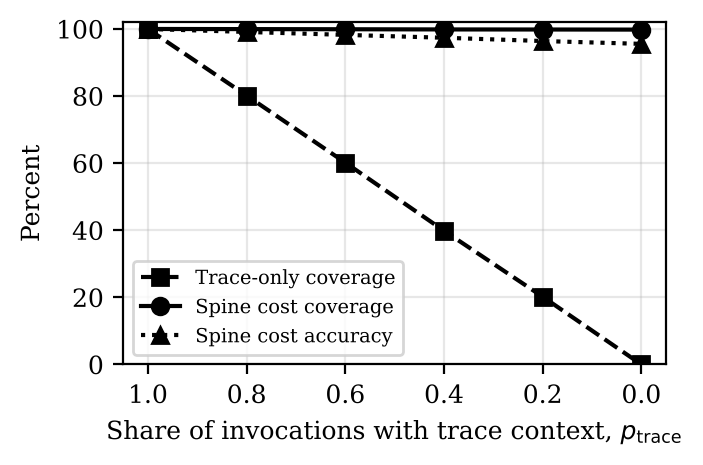
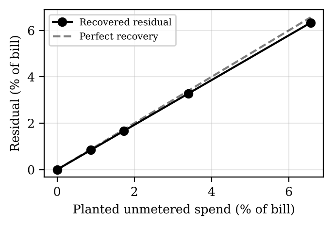
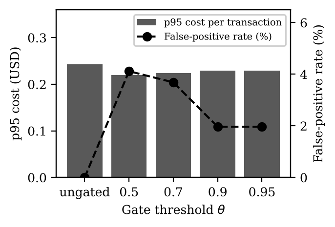

# Two-Ledger Model: simulation code and synthetic data

Code and synthetic data for the simulation study in:

> V. Acharya, "The Two-Ledger Model: Transaction-Grain Cost Accounting for Multi-Agent AI Systems Across Clouds, Models, and Systems of Record," manuscript submitted for publication, 2026.

The Two-Ledger Model joins a FOCUS-conformant **settlement ledger** (what providers bill) to an invocation-grain **attribution ledger** (what each model call cost and which business transaction it served). A layered correlation spine assigns each call to its transaction, a versioned rate card prices it on write, and period reconciliation ties both ledgers to the invoice. This repository tests those mechanisms on synthetic data where the right answer is known.

**Patent notice.** The methods simulated here are the subject of a U.S. provisional patent application by the author. The license below grants no patent rights.

## What the study tests

Every synthetic usage record carries its true business transaction, so each result is measured against known ground truth.

| Experiment | Question | Result |
|---|---|---|
| **E1** Correlation spine | How do attribution coverage and accuracy hold up as trace propagation degrades? | Cost coverage stays above 99% as trace propagation falls to zero, while cost accuracy falls to 95.6%. In a harder setting, raising the confidence floor from 0.80 to 0.95 takes misattribution from 7.6% to zero and moves 15.6% of spend to labeled pools. |
| **E2** Reconciliation | Can the reconciliation residual recover unmetered ("shadow AI") spend from observable data alone? | Planted unmetered spend is recovered within 0.24 percentage points of the bill. A planted 3% provider overbilling is flagged at its exact amount, and a planted 2% usage omission shows up as a negative residual. |
| **E3** Mid-flight gating | Can a forecast-based gate cut the cost tail from runaway agent loops? | p99 cost per transaction falls 49–61% at false-pause rates of 2.0–4.1%. |

| E1: coverage and accuracy | E2: recovered vs planted | E3: tail cost and false pauses |
|---|---|---|
|  |  |  |

## Run it

```bash
pip install -r requirements.txt
python3 twoledger_sim.py --out results --export-data data
python3 verify_data.py
```

The run takes about a minute. It writes `results.json`, the three LaTeX tables, and the figures (PDF and PNG) to `results/`, and every synthetic dataset to `data/`. `verify_data.py` rebuilds the E2 reconciliation from the CSV files alone and checks it against `results/results.json`.

## Layout

```
twoledger_sim.py     the simulation: data generator, correlation spine (E1),
                     reconciliation engine (E2), forecaster and gate (E3)
verify_data.py       checks the published data against the published results
results/             results.json, table_e1-e3.tex, fig_e1-e3 (PDF and PNG)
data/                synthetic datasets, described in data/README.md
```

## Data

All data are generated by `twoledger_sim.py` from a fixed seed. Nothing comes from a production system, and providers, SKUs, rates, and systems of record are generic.

| Folder | Contents |
|---|---|
| `data/evaluation/` | 20,000 business transactions and their 109,792 model invocations. Used for E1, E2, and as the E3 test set. |
| `data/calibration/` | 4,000 transactions (21,804 invocations) used to calibrate probabilistic matching. |
| `data/training/` | 12,000 transactions (65,707 invocations) used to fit the E3 forecaster. |
| `data/e2_reconciliation/` | Price sheet, plus one folder per planted unmetered level (0, 1, 2, 4, 8%) with the billing export, rate card, and commitment contract the engine sees, the planted ground truth it never sees, and the engine's decomposition. |

Column definitions are in [`data/README.md`](data/README.md).

## Reproducibility

- Seed `20261103`. Each run regenerates the same data and results.
- `requirements.txt` pins the versions the published results came from (Python 3.13, numpy 2.5.3, matplotlib 3.11.2). With those versions a run reproduces `results/results.json` exactly. Other numpy versions may change the last digits, because numpy does not promise identical random streams across releases.
- The data export draws no random numbers, so results are the same with or without `--export-data`.

## Scope

The generator's parameters (failure and retry rates, runaway frequency, key collisions, event-feed availability, provider rounding) are chosen, not measured. The study shows whether the mechanisms behave as the architecture claims under controlled conditions. It does not estimate cost levels in any real deployment.

## Citation

Use the "Cite this repository" button (from `CITATION.cff`), or cite the paper above.

## License

Code and data are released under the [Clear BSD License](LICENSE) (BSD-3-Clause-Clear). You may use, modify, and share them with attribution. The license grants no patent rights.

## Contact

Vivek Acharya, Independent Researcher, Dallas, TX, USA · vacharya@bu.edu · ORCID [0009-0002-0860-9462](https://orcid.org/0009-0002-0860-9462)
